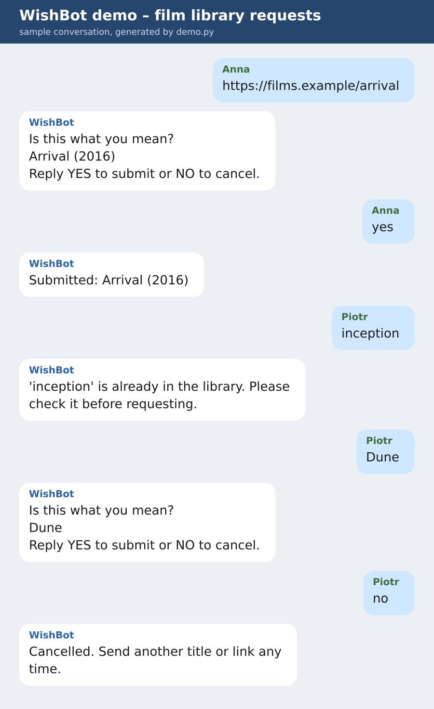

# WishBot: Community Request Bot (demo project)

A Telegram bot for community admins who collect requests from group members
(here: a shared film library). It confirms every request with the member, blocks duplicates
and passes clean requests to the admin through a Google Form,
so nobody has to copy messages by hand.

This is a personal demo project, not client work. It contains no client data.



## How it works
1. A member posts a title or a link in the group.
2. The bot reads the link preview (Open Graph title) and asks: "Is this what you mean?"
3. After the member confirms, the bot checks a local catalog to prevent duplicates.
4. New requests are submitted automatically through a Google Form.
5. If a title is already in the library, the bot says so right away and nothing is submitted.

## Features
- **Confirmation step**: nothing is submitted until the member says YES; NO cancels.
- **Duplicate catalog** (SQLite): matching ignores case, punctuation and accents,
  so "Żółw i zając" and "zolw i zajac" count as the same title. Works for any alphabet.
- **Google Form submission** with no extra services or paid APIs.
- **Chat lock**: the bot answers only in the chat set in `allowed_chat_id`.
- **Failure handling**: if the form is down, the request stays pending and the member can retry with YES.
- **Standard library only**, 11 offline unit tests, all network calls injected.

## Stack
Python 3 (standard library only), Telegram Bot API, SQLite, Google Forms.

## Run
```
cp config.example.json config.json   # add your token, chat ID and form fields
python bot.py config.json
python -m unittest                    # run the tests
python demo.py                        # print a sample conversation, no network needed
```

## Project layout
| File | Purpose |
|---|---|
| `core.py` | Request flow and duplicate catalog (pure logic) |
| `bot.py` | Telegram long-polling runner |
| `forms.py` | Google Form submitter |
| `preview.py` | Reads the page title of a shared link |
| `test_core.py` | Unit tests |
| `demo.py` | Offline demo that prints the conversation above |

## Want a bot like this?
Request bots, intake flows and admin notifications for Telegram, Discord or web chat.
See also [bot-kit](https://github.com/jabloniec8372-cpu/bot-kit), a set of reliability building blocks
(idempotency, outbox, health checks) for production request bots.
